<!-- cite: main="Claude"; last="Matheus Hoffmann" -->

# Versão fácil: os 33 pensadores

> **Esta é a versão fácil, em português, de [50THINKERS.md](50THINKERS.md).**
>
> - **Vale o original.** Se este texto e o original discordarem, vale o original, em inglês.
> - **Feita a partir de:** a versão do original de 12 de novembro de 2026.
> - **Para quem é:** quem quer saber quem está no livro, e por quê, sem ser da área.
> - **O que ficou de fora:** nada. A tabela está inteira, com as 33 linhas na mesma ordem.
> - **O que entrou a mais:** uma lista das palavras difíceis, no fim. Ela explica palavras; não
>   diz nada novo sobre o livro.
> - **Escrita por:** Claude, com a skill [`easy-pt-br`](.claude/skills/easy-pt-br/SKILL.md);
>   revisão de Matheus Hoffmann.

## A regra do livro

O livro tem uma regra fixa, escrita em `AGENTS.md`: **66 páginas, 33 autores, duas páginas para
cada autor.**

- Cada pensador recebe duas páginas, escritas em primeira pessoa (com "eu").
- A capa traz o nome Mr. Nobody ("Sr. Ninguém").
- O comando `just check` confere a tabela abaixo. Ele falha em três casos: a tabela não tem
  exatamente 33 linhas numeradas; um nome aparece duas vezes; ou um pensador não está na lista
  longa, [500AUTHORS.md](500AUTHORS.md).

## A ordem é embaralhada de propósito

O livro é um ensaio. Ele não é um ranking, não é uma linha do tempo e não é uma classificação.

O número de um pensador não diz nada sobre a importância dele, a época ou a área. O número é só
a ordem em que o ensaio encontra cada um. Por isso um criptógrafo pode ficar ao lado de um poeta.

A ordem foi sorteada em 13 de outubro de 2026. No primeiro sorteio, Cicero, Aristotle e Plato
ficaram um ao lado do outro. Por isso ela foi sorteada de novo, no mesmo dia, até que dois
vizinhos nunca tivessem a mesma área. O dono do repositório muda linhas de lugar quando
o ensaio pede. Não ordene esta tabela.

Em 12 de novembro de 2026, o dono cortou a lista de 50 para 33 pensadores. As 33 linhas
ficaram na mesma ordem e ganharam números novos. Dois vizinhos continuam sem a mesma área.

## De onde veio a lista

- A tabela começou com as pessoas que o artigo já cita (`refs.bib`) e com os livros de
  [BOOKS.md](BOOKS.md).
- O dono escolheu o resto em 13 de outubro de 2026.
- Uma linha aberta guarda o lugar do pensador de engenharia reversa que o dono ainda vai nomear.
- Qualquer linha pode mudar: quem escolhe os 33 é o dono.
- Nenhum guru de IA autoproclamado é pensador aqui. Eles são os adversários do livro
  (`AGENTS.md`).

Depois das 66 páginas vem um recorte parcial do repositório privado `h0ffmann/nagori`. Ele fica
fora da contagem. O dono escolhe o que entra nele (`AGENTS.md`).

## Como ler a tabela

- **Área** é o campo de trabalho do pensador.
- **Citado** tem ☑ quando o artigo já cita uma obra do pensador (ele é autor em
  `papers/closed-source/refs.bib`). Tem ☐ quando ainda não cita. Tem — numa linha aberta.
- **Situação** tem quatro valores:
  - `open` (aberta): ainda não há pensador;
  - `proposed` (proposto);
  - `chosen` (escolhido);
  - `written` (escrito): as duas páginas existem.

Os nomes das pessoas e os títulos das obras ficam como no original. "Seção 2" quer dizer a seção
2 do artigo.

## A linha do tempo

A vida de cada pensador, numa linha do tempo ([timeline/thinkers.svg](timeline/thinkers.svg)). Onde
há um corte (≈), a linha pula muitos anos sem nenhum pensador. A escala é a mesma em todo o
desenho.

## A tabela

| # | Pensador | Área | Por que está no livro | Citado | Situação |
|---:|---|---|---|:---:|---|
| 1 | Mário Ferreira dos Santos | filosofia | filósofo brasileiro, *Filosofia Concreta* (1957); pitagórico (*Pitágoras e o Tema do Número*, 1956) | ☐ | chosen |
| 2 | Austin Kleon | criatividade | *Steal Like an Artist* (2012; *Roube como um Artista*, Rocco, 2013): o trabalho criativo se apoia no trabalho dos outros | ☐ | chosen |
| 3 | Socrates | matemática | matemática | ☐ | chosen |
| 4 | Gregory Wolfe | literatura, cultura | *Beauty Will Save the World* (2011; *A Beleza Salvará o Mundo*): recuperar o humano numa época ideológica | ☐ | chosen |
| 5 | Edmund Burke | política, filosofia | mais tarde chamado de fundador do conservadorismo; em 1775 ele foi contra estender a patente da máquina a vapor de Watt, e a favor de estender uma patente de porcelana (notes/202610130526) | ☐ | chosen |
| 6 | Carl Jung | psicologia | teoria dos sonhos: sonhos e mitos como a língua do inconsciente; arquétipos e o inconsciente coletivo; o Ouroboros como arquétipo (*Obras Completas* 14) | ☐ | chosen |
| 7 | Julia Cameron | criatividade | *The Artist's Way* (1992; *O Caminho do Artista*): criatividade como prática diária | ☐ | chosen |
| 8 | Dante Alighieri | literatura | motivo a escrever | ☐ | chosen |
| 9 | Nicholas Carlini | segurança de aprendizado de máquina | roubo de parte de um modelo de linguagem em produção (Seção 4) | ☑ | proposed |
| 10 | Fiódor Dostoiévski | literatura | "O Sonho de um Homem Ridículo" (1877); notas depois | ☐ | chosen |
| 11 | Hans-Hermann Hoppe | economia, filosofia | a fórmula do título; ideias não podem ser propriedade (BOOKS.md) | ☐ | proposed |
| 12 | Florian Tramèr | segurança de aprendizado de máquina | extração de modelos por meio de APIs de previsão (Seção 4) | ☑ | proposed |
| 13 | Arfon M. Smith | software de pesquisa | princípios de citação de software (Seção 6) | ☑ | proposed |
| 14 | Olavo de Carvalho | filosofia | *O Jardim das Aflições* (1995), e *Símbolos e Mitos no Filme "O Silêncio dos Inocentes"* | ☐ | chosen |
| 15 | John F. Nash | matemática | segurança que vem do custo de calcular, as cartas de 1955 (Seção 5a) | ☑ | proposed |
| 16 | Luiz Felipe Pondé | filosofia | filósofo brasileiro; motivo a escrever | ☐ | chosen |
| 17 | Cicero | matemática | matemática | ☐ | chosen |
| 18 | Robert M. Pirsig | filosofia | Qualidade, e cuidar da própria máquina (BOOKS.md) | ☐ | proposed |
| 19 | — | — | o principal pensador de engenharia reversa de 2026 (ainda sem nome) | — | open |
| 20 | Jiang Xueqin | história | as aulas Predictive History (YouTube, desde 2023); motivo a escrever | ☐ | chosen |
| 21 | Hideaki Anno | animação | criador de *Neon Genesis Evangelion*, o anime mais clássico da história | ☐ | chosen |
| 22 | Theodore Dalrymple | ensaios | a escrever mais tarde | ☐ | chosen |
| 23 | Stanley Kubrick | cinema | "o destruidor do revisor por pares" (palavras do dono): *De Olhos Bem Fechados* (1999), seu último filme, uma obra sobre segredos | ☐ | chosen |
| 24 | Isaac Asimov | literatura, ficção científica | motivo a escrever | ☐ | chosen |
| 25 | personX | — | quem compartilha, multiplica | ☐ | chosen |
| 26 | Plato | matemática | matemática | ☐ | chosen |
| 27 | Pamela Samuelson | direito | direito e economia da engenharia reversa | ☑ | proposed |
| 28 | Eric S. Raymond | engenharia de software | a catedral e o bazar (Seção 2, trabalhos relacionados) | ☑ | proposed |
| 29 | Marcus Baffa | — | a explicar | ☐ | chosen |
| 30 | George Orwell | literatura | motivo a escrever | ☐ | chosen |
| 31 | Aristotle | matemática | matemática | ☐ | chosen |
| 32 | Suzanne Scotchmer | economia | direito e economia da engenharia reversa | ☑ | proposed |
| 33 | Michel de Montaigne | ensaios, filosofia | os *Ensaios*: por que alguém escreve | ☐ | chosen |

## Palavras difíceis

Cada linha explica uma palavra da tabela. Nenhuma diz algo novo sobre o livro.

- **Engenharia reversa**: desmontar uma coisa pronta para descobrir como ela foi feita.
- **Código aberto**: programa cujo texto qualquer pessoa pode ler, usar e mudar.
- **Modelo de linguagem**: um programa de IA que escreve texto.
- **Extração de modelo**: copiar um modelo só fazendo perguntas a ele e guardando as respostas.
- **API**: a porta pela qual um programa faz pedidos a outro.
- **Patente**: o direito, dado pelo Estado, de ser o único a explorar uma invenção por um tempo.
- **Citação de software**: dar o crédito a um programa do mesmo jeito que se dá a um artigo.
