<!-- cite: main="Claude"; last="Matheus Hoffmann" -->

# The 33 thinkers

The hard rule of the book (AGENTS.md): **66 pages, 33 authors, two pages per author.** Each
thinker gets two first-person pages. The cover names Mr. Nobody. `just check` fails if this table
does not have exactly 33 numbered rows, if a name appears twice, or if a thinker is missing from
the long list in [500AUTHORS.md](500AUTHORS.md).

> **The order is shuffled on purpose.** The book is an essay, not a ranking, a timeline or a
> taxonomy. A thinker's number says nothing about rank, era or area: it is the order in which the
> essay meets them, so that a cryptographer may sit next to a poet. The order was drawn at random
> (13 October 2026), and drawn again the same day until no two neighbours share an area, because
> the first draw put Cicero, Aristotle and Plato in a row. The owner moves rows to suit the
> essay. Do not sort this table. On 12 November 2026 the owner cut the roster from 50 to 33
> ([the change proposal](docs/2-engineering/changes/2026-11-12-33-thinkers/proposal.md)); the 33
> rows kept their order and were numbered again, and still no two neighbours share an area.

The table started from the people the paper already cites (refs.bib) and the books in BOOKS.md;
the owner chose the rest on 13 October 2026, and one open row keeps a place for the
reverse-engineering thinker the owner will name. Change any row: the owner chooses the 33. No
proclaimed AI guru is a thinker here: they are the book's opponents (AGENTS.md).

After the 66 pages comes a partial snapshot of the private `h0ffmann/nagori` repository, outside
the count; the owner chooses what it holds (AGENTS.md).

Their lives, on one line of time ([timeline/thinkers.svg](timeline/thinkers.svg), drawn by
`tools/fabric timeline` from [timeline/lives.tsv](timeline/lives.tsv), the `ouro-timeline` skill):

Columns: **Area** is the thinker's field. **Cited** is ☑ when the paper already cites the thinker's
work (an author in `papers/closed-source/refs.bib`), ☐ when it does not yet, and — on an open row.
**Status** is `open` (no thinker yet), `proposed`, `chosen` or `written` (the two pages exist).

| # | Thinker | Area | Why in this book | Cited | Status |
|---:|---|---|---|:---:|---|
| 1 | Mário Ferreira dos Santos | philosophy | Brazilian philosopher, *Filosofia Concreta* (1957); Pythagorean (*Pitágoras e o Tema do Número*, 1956) | ☐ | chosen |
| 2 | Austin Kleon | creativity | *Steal Like an Artist* (2012; *Roube como um Artista*, Rocco, 2013): creative work builds on the work of others | ☐ | chosen |
| 3 | Socrates | mathematics | mathematics | ☐ | chosen |
| 4 | Gregory Wolfe | literature, culture | *Beauty Will Save the World* (2011; *A Beleza Salvará o Mundo*): recovering the human in an ideological age | ☐ | chosen |
| 5 | Edmund Burke | politics, philosophy | later named the founder of conservatism; in 1775 he opposed the extension of Watt's steam-engine patent, and backed the extension of a porcelain patent (notes/202610130526) | ☐ | chosen |
| 6 | Carl Jung | psychology | dream theory: dreams and myths as the language of the unconscious; archetypes and the collective unconscious; the Ouroboros as an archetype (*Collected Works* 14) | ☐ | chosen |
| 7 | Julia Cameron | creativity | *The Artist's Way* (1992; *O Caminho do Artista*): creativity as a daily practice | ☐ | chosen |
| 8 | Dante Alighieri | literature | reason to come | ☐ | chosen |
| 9 | Nicholas Carlini | machine learning security | stealing part of a production language model (Section 4) | ☑ | proposed |
| 10 | Fyodor Dostoevsky | literature | "The Dream of a Ridiculous Man" (1877); notes to come | ☐ | chosen |
| 11 | Hans-Hermann Hoppe | economics, philosophy | the title formula; ideas cannot be property (BOOKS.md) | ☐ | proposed |
| 12 | Florian Tramèr | machine learning security | model extraction through prediction APIs (Section 4) | ☑ | proposed |
| 13 | Arfon M. Smith | research software | software citation principles (Section 6) | ☑ | proposed |
| 14 | Olavo de Carvalho | philosophy | *O Jardim das Aflições* (1995), and *Símbolos e Mitos no Filme "O Silêncio dos Inocentes"* | ☐ | chosen |
| 15 | John F. Nash | mathematics | security from computational cost, the 1955 letters (Section 5a) | ☑ | proposed |
| 16 | Luiz Felipe Pondé | philosophy | Brazilian philosopher; reason to come | ☐ | chosen |
| 17 | Cicero | mathematics | mathematics | ☐ | chosen |
| 18 | Robert M. Pirsig | philosophy | Quality, and maintaining your own machine (BOOKS.md) | ☐ | proposed |
| 19 | — | — | the foremost reverse-engineering thinker of 2026 (to be named) | — | open |
| 20 | Jiang Xueqin | history | the Predictive History lectures (YouTube, since 2023); reason to come | ☐ | chosen |
| 21 | Hideaki Anno | animation | creator of *Neon Genesis Evangelion*, the most classical anime in history | ☐ | chosen |
| 22 | Theodore Dalrymple | essays | to be written later | ☐ | chosen |
| 23 | Stanley Kubrick | cinema | "the peer reviewer destroyer" (the owner): *Eyes Wide Shut* (1999), his last film, a work on secrets (`notes/202610140034-peer-reviewing-the-god-that-failed.md`) | ☐ | chosen |
| 24 | Isaac Asimov | literature, science fiction | reason to come | ☐ | chosen |
| 25 | personX | — | who shares, multiplies | ☐ | chosen |
| 26 | Plato | mathematics | mathematics | ☐ | chosen |
| 27 | Pamela Samuelson | law | law and economics of reverse engineering | ☑ | proposed |
| 28 | Eric S. Raymond | software engineering | the cathedral and the bazaar (Section 2, related work) | ☑ | proposed |
| 29 | Marcus Baffa | — | to be explained | ☐ | chosen |
| 30 | George Orwell | literature | reason to come | ☐ | chosen |
| 31 | Aristotle | mathematics | mathematics | ☐ | chosen |
| 32 | Suzanne Scotchmer | economics | law and economics of reverse engineering | ☑ | proposed |
| 33 | Michel de Montaigne | essays, philosophy | the *Essays*: why one writes at all | ☐ | chosen |
