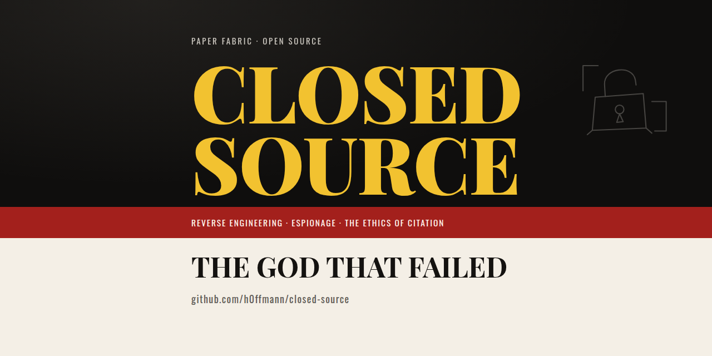

<!-- cite: main="Claude"; last="Matheus Hoffmann" -->

# The repository's social preview

`social-preview.png` is the picture that a link to this repository shows in a chat or a feed
(WhatsApp, LinkedIn, Slack). It is the website's cover, made small: the black field, "Closed
Source" in yellow, the red band, "The God that Failed" in black on paper. The colours and the
type are those of `site/static/style.css`.



## Put it on GitHub

Only the owner can, and only by hand: GitHub has no API for it.

1. Open the repository's settings: `https://github.com/h0ffmann/closed-source/settings`. The
   address is written as code and not as a link, because only the owner can open it: to anyone
   else, and to the link check, it answers 404.
2. In "General", go down to "Social preview".
3. Choose "Edit", then "Upload an image", and give it `social-preview.png`.

A chat keeps an old picture for some time. A link sent before the upload may show the old one.

## The limits it keeps

GitHub's documentation, read on 13 October 2026
([Customizing your repository's social media preview](https://docs.github.com/en/repositories/managing-your-repositorys-settings-and-features/customizing-your-repository/customizing-your-repositorys-social-media-preview)):
"Your image should be a PNG, JPG, or GIF file under 1 MB in size", and "we recommend a size of
at least 640 by 320 pixels (1280 by 640 pixels for best display)".

| Limit | This file |
|---|---|
| PNG, JPG or GIF | PNG |
| under 1 MB | 117 kB |
| 1280 by 640 for best display | 1280 by 640 |

## The middle square

A large preview shows the whole picture. A small one cuts it to a square from the middle. So
every word is inside the middle square: 640 by 640, from x = 320 to x = 960. The text column is
592 wide and has 24 on each side inside that square. Above and below, the text keeps 62 or more
from the edge.

Outside the square there is only decoration: the open padlock of the paper's tile, on the right.
A small preview loses it and loses no word.

This was checked on the file: the square was cut out and read. It was not checked on a phone.

## Make it again

`cover.html` is the source. It reads the padlock from `site/static/drawings/` and the fonts from
Google Fonts, as the website does, so serve the repository and take the picture:

```sh
python3 -m http.server 8766 &
google-chrome --headless=new --hide-scrollbars --force-device-scale-factor=1 \
  --window-size=1280,800 --virtual-time-budget=9000 --screenshot=raw.png \
  http://localhost:8766/docs/social/github/cover.html
```

Then cut `raw.png` to its top 1280 by 640. The window is taller than the picture because
Chrome's new headless mode gives a page less height than the window has.

## Sources

- The design is this website's cover (`site/static/style.css`, "The cover"), which follows the
  type and colours of the cover of Hoppe's *Democracy: The God That Failed*; no cover art is
  reproduced ([`BOOKS.md`](../../../BOOKS.md)).
- The padlock is `site/static/drawings/padlock.svg`, drawn for this repository.
