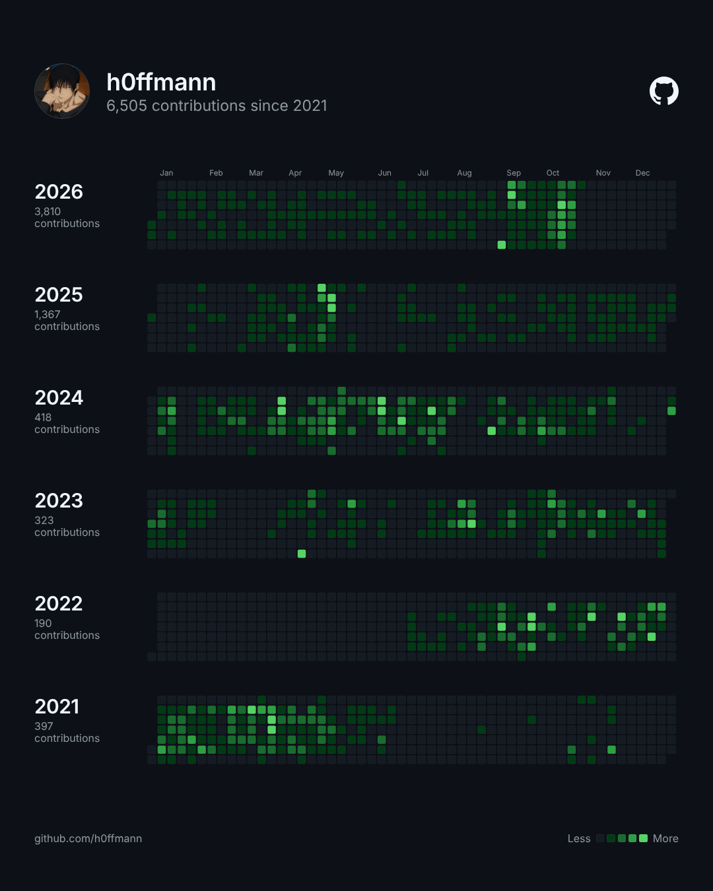

<!-- cite: main="Claude"; last="Matheus Hoffmann" -->

# instagram_002: GitHub contributions, year by year

Made in the "Marola UX" Claude project on 2026-10-25, for Hoffmann's personal Instagram page,
@hffmnn_. Indexed here so that it stays on record. This index does not say whether it was posted:
when it is, put the link in `instagram:` above. The owner posts it; an agent does not.

Hoffmann's GitHub contribution chart, one row for each year from 2021 to 2026, in GitHub's
dark theme, with his avatar and "6,505 contributions since 2021". The owner asked for it with
the current look of GitHub, his new avatar, and the years from 2021 on.

| File | What it is |
|---|---|
| [github-contribs-post.png](github-contribs-post.png) | post, 1080x1350 (4:5) |
| [github-contribs-story.png](github-contribs-story.png) | story, 1080x1920 (9:16) |

## Caption (pt-BR)

No caption was written in the project. The owner's working title for the idea was
"always busy for lazy": the jump of 2025 and 2026 comes with agents that program alongside him.
A suggestion from the project, not posted: "always busy for lazy: 397 contribuições em 2021, 3,810
em 2026, e eu digitando cada vez menos".

## Sources

The daily counts are in [`data/`](data/), one file for each year from 2016 to 2026, one line
for each day with contributions (`date count level`). They were read on 2026-10-25 from a public
mirror of the contribution chart, because GitHub's API was not reachable from the project; each
year's sum matches the yearly total of the same mirror. They were not compared with the GitHub
page itself. Sums by year: 2016: 20; 2017: 76; 2018: 45; 2019: 93; 2020: 160; 2021: 397; 2022:
190; 2023: 323; 2024: 418; 2025: 1,367; 2026 (to 2026-10-25): 3,810. The essay
[Why I write, 2026](../../../essays/2026-why-i-write.md) uses them.

## Alt text

1. A dark page in GitHub's style. At the top, the avatar and the name h0ffmann, with 6,505
   contributions since 2021, and the GitHub mark. Below, six rows of green squares, one for each
   year from 2026 down to 2021, each with its total: 3,810; 1,367; 418; 323; 190; 397. The
   squares of September and October 2026 are the brightest. At the foot, github.com/h0ffmann and
   the Less-More legend.
