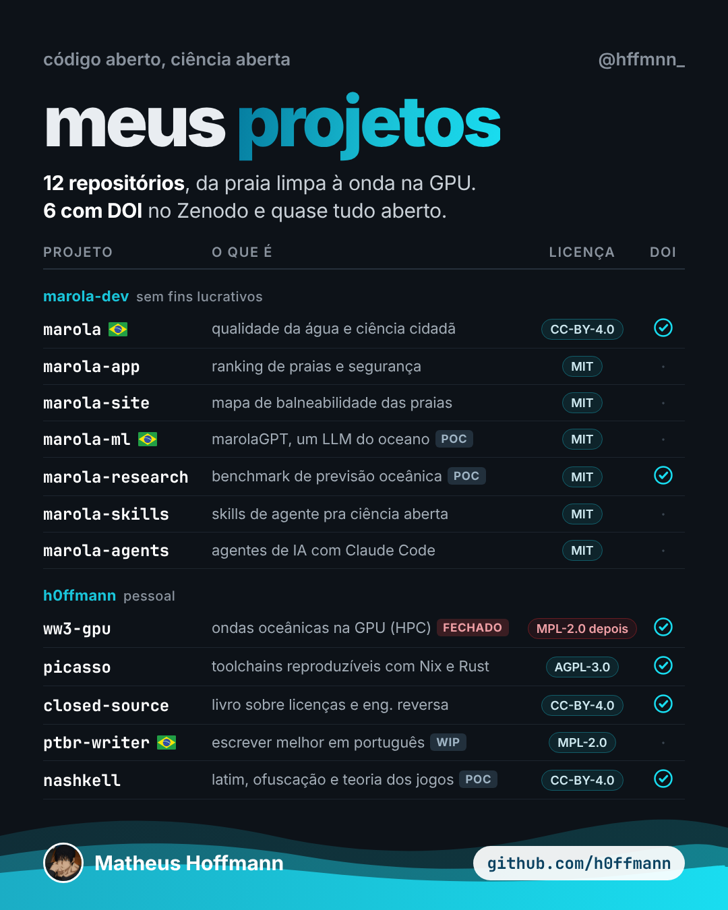

<!-- cite: main="Claude"; last="Matheus Hoffmann" -->

# instagram_003: meus projetos: twelve repositories

Made in the "Marola UX" Claude project on 2026-10-25, for Hoffmann's personal Instagram page,
@hffmnn_. Indexed here so that it stays on record. This index does not say whether it was posted:
when it is, put the link in `instagram:` above. The owner posts it; an agent does not.

A table of Hoffmann's twelve repositories, in two groups: seven of marola-dev, not for
profit, and five personal ones. Each row gives the project, what it is, its licence and whether it
has a DOI. Six have a DOI on Zenodo.

| File | What it is |
|---|---|
| [projetos-post.png](projetos-post.png) | post, 1080x1350 (4:5) |
| [projetos-story.png](projetos-story.png) | story, 1080x1920 (9:16) |



## Caption (pt-BR)

```text
meus projetos 🌊

12 repositórios, da praia limpa à onda na GPU. a maioria mora no marola.dev, um projeto aberto e sem fins lucrativos sobre qualidade da água e ciência cidadã no Rio.

6 deles têm DOI no Zenodo, então dá pra citar como qualquer artigo. quase tudo é código aberto: lê, confere, abre issue, manda PR.

o ww3-gpu (ondas oceânicas na GPU) ainda é fechado, mas aberto a conversas comerciais e entrevistas.

DOIs no Zenodo:
marola 10.5281/zenodo.23224155
ww3-gpu 10.5281/zenodo.23221351
picasso 10.5281/zenodo.23311208
closed source 10.5281/zenodo.23333656
marola-bench 10.5281/zenodo.23352633
nashkell 10.5281/zenodo.23356739

github.com/h0ffmann · link na bio

#codigoaberto #opensource #cienciaaberta #openscience #oceanografia #programacao #github #riodejaneiro #marola
```

## Sources

The licences and the DOIs are those of the caption and of the repositories' own pages
as the project read them on 2026-10-25. The DOIs are listed in the caption.

## Alt text

1. A dark card titled "meus projetos", from @hffmnn_, under "código aberto, ciência aberta".
   "12 repositórios, da praia limpa à onda na GPU. 6 com DOI no Zenodo e quase tudo aberto." A
   table with the columns projeto, o que é, licença, DOI. marola-dev, sem fins lucrativos:
   marola, marola-app, marola-site, marola-ml, marola-research, marola-skills, marola-agents.
   h0ffmann, pessoal: ww3-gpu (fechado, MPL-2.0 depois), picasso, closed-source, ptbr-writer,
   nashkell. A wave at the foot, with Matheus Hoffmann and github.com/h0ffmann.
