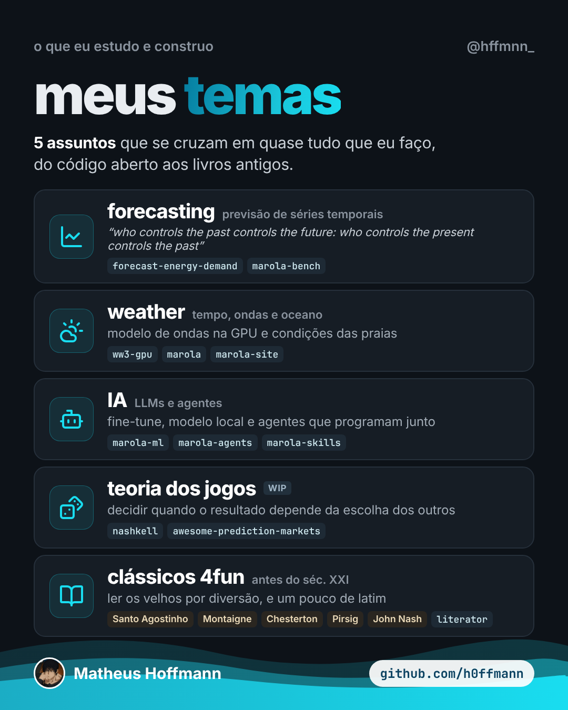

<!-- cite: main="Claude"; last="Matheus Hoffmann" -->

# instagram_004: meus temas: five subjects

Made in the "Marola UX" Claude project on 2026-10-25, for Hoffmann's personal Instagram page,
@hffmnn_. Indexed here so that it stays on record. This index does not say whether it was posted:
when it is, put the link in `instagram:` above. The owner posts it; an agent does not.

Five subjects that run through Hoffmann's work: forecasting, weather, AI, game theory and
the classics before the twenty-first century, each with the repositories that belong to it.

| File | What it is |
|---|---|
| [temas-post.png](temas-post.png) | post, 1080x1350 (4:5) |
| [temas-story.png](temas-story.png) | story, 1080x1920 (9:16) |



## Caption (pt-BR)

```text
meus temas 📈🌦️🤖♟️📚

5 assuntos que se cruzam em quase tudo que eu faço:

forecasting: “who controls the past controls the future: who controls the present controls the past”
weather: modelo de ondas na GPU (ww3-gpu) e condições das praias no marola.dev.
IA: fine-tune, modelo local e agentes que programam junto.
teoria dos jogos (WIP): decidir quando o resultado depende da escolha dos outros.
clássicos 4fun: tudo antes do século XXI. Santo Agostinho, Montaigne, Chesterton, Robert M. Pirsig, John Nash e um pouco de latim.

DOIs no Zenodo:
marola 10.5281/zenodo.23224155
ww3-gpu 10.5281/zenodo.23221351
picasso 10.5281/zenodo.23311208
closed source 10.5281/zenodo.23333656
marola-bench 10.5281/zenodo.23352633
nashkell 10.5281/zenodo.23356739

github.com/h0ffmann · link na bio

#forecasting #weather #oceanografia #ia #teoriadosjogos #classicos #codigoaberto #cienciaaberta #programacao
```

## Sources

The caption gives the quotation on forecasting without a name. Its source was not checked
for this index, so none is given here.

## Alt text

1. A dark card titled "meus temas", from @hffmnn_, under "o que eu estudo e construo".
   "5 assuntos que se cruzam em quase tudo que eu faço, do código aberto aos livros antigos."
   Five boxes, each with an icon: forecasting, with a quotation about the past and the future;
   weather, waves on the GPU and beach conditions; IA, fine-tune, local models and agents that
   program alongside; teoria dos jogos (WIP); clássicos 4fun, with Santo Agostinho, Montaigne,
   Chesterton, Pirsig and John Nash. A wave at the foot, with Matheus Hoffmann and
   github.com/h0ffmann.
