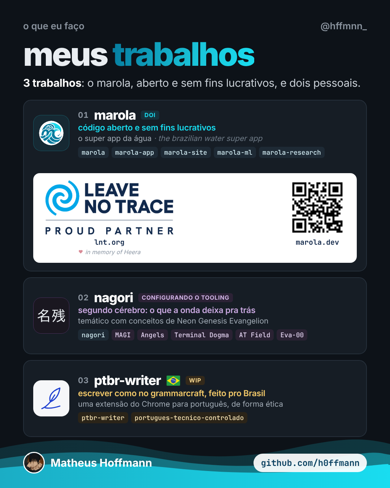

<!-- cite: main="Claude"; last="Matheus Hoffmann" -->

# instagram_005: meus trabalhos: marola, nagori and ptbr-writer

Made in the "Marola UX" Claude project on 2026-10-25, for Hoffmann's personal Instagram page,
@hffmnn_. Indexed here so that it stays on record. This index does not say whether it was posted:
when it is, put the link in `instagram:` above. The owner posts it; an agent does not.

Hoffmann's three works: marola, open source and not for profit, a Leave No Trace partner;
nagori, his second brain, themed on *Neon Genesis Evangelion*; and ptbr-writer, a Chrome
extension for writing in Portuguese.

| File | What it is |
|---|---|
| [trabalhos-post.png](trabalhos-post.png) | post, 1080x1350 (4:5) |
| [trabalhos-story.png](trabalhos-story.png) | story, 1080x1920 (9:16) |



## Caption (pt-BR)

```text
meus trabalhos 🌊名残🪶

01 marola: código aberto e sem fins lucrativos. o super app da água (the brazilian water super app), feito com cinco amigos, parceiro do Leave No Trace (lnt.org). marola.dev

02 nagori 名残: meu segundo cérebro. o nome quer dizer "o que a onda deixa pra trás". é temático com conceitos de Neon Genesis Evangelion: MAGI pra decidir, Angels pros problemas, Terminal Dogma na raiz. ainda configurando o tooling.

03 ptbr-writer 🇧🇷: escrever como no grammarcraft, feito pro Brasil. uma extensão do Chrome para português, de forma ética. ainda em construção.

DOIs no Zenodo:
marola 10.5281/zenodo.23224155
ww3-gpu 10.5281/zenodo.23221351
picasso 10.5281/zenodo.23311208
closed source 10.5281/zenodo.23333656
marola-bench 10.5281/zenodo.23352633
nashkell 10.5281/zenodo.23356739

github.com/h0ffmann · link na bio

#codigoaberto #opensource #segundocerebro #evangelion #oceanografia #leavenotrace #programacao #marola
```

## Sources

The Leave No Trace logo is that organisation's mark, shown because marola is a partner
(lnt.org); it is not under this repository's licence. The QR code opens marola.dev. nagori is
private: the post names it and its themes, and nothing of its text.

## Alt text

1. A dark card titled "meus trabalhos", from @hffmnn_, under "o que eu faço". "3 trabalhos:
   o marola, aberto e sem fins lucrativos, e dois pessoais." 01 marola, with a DOI badge: código
   aberto e sem fins lucrativos, o super app da água, and its five repositories; below it a white
   band with the Leave No Trace "proud partner" logo, a dedication line and a QR code to
   marola.dev. 02 nagori, 名残, configurando o tooling: segundo cérebro, o que a onda deixa pra
   trás, temático com conceitos de Neon Genesis Evangelion. 03 ptbr-writer (WIP): escrever como
   no grammarcraft, feito pro Brasil. A wave at the foot, with Matheus Hoffmann and
   github.com/h0ffmann.
