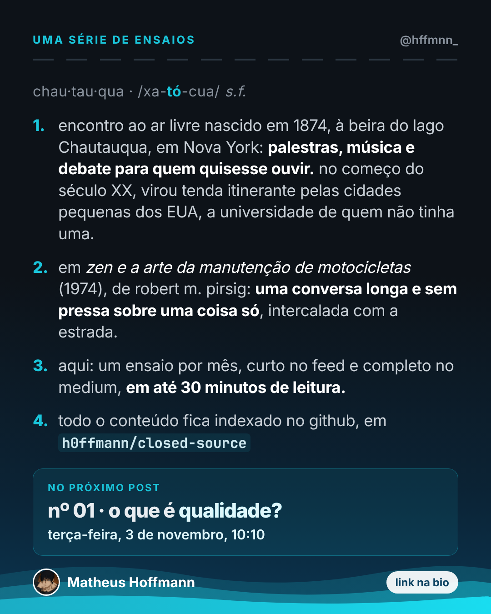

<!-- cite: main="Claude"; last="Matheus Hoffmann" -->

# instagram_006: Chautauqua: the series of essays

Made in the "Marola UX" Claude project on 2026-10-25, for Hoffmann's personal Instagram page,
@hffmnn_. Indexed here so that it stays on record. This index does not say whether it was posted:
when it is, put the link in `instagram:` above. The owner posts it; an agent does not.

The opening post of Chautauqua, a monthly series of essays: a definition of the word, its
use by Pirsig, the promise of one essay a month (short on Instagram, full on Medium, up to 30
minutes of reading), and the next number. The essays are indexed here, in
[`essays/`](../../../essays/index.md); the first one is
[Why I write, 2026](../../../essays/2026-why-i-write.md).

| File | What it is |
|---|---|
| [chautauqua-def-post.png](chautauqua-def-post.png) | post, 1080x1350 (4:5) |
| [chautauqua-def-story.png](chautauqua-def-story.png) | story, 1080x1920 (9:16) |



## Caption (pt-BR)

```text
chautauqua 🏍️🌊

chau·tau·qua (xa-tó-cua), substantivo feminino.

em 1874, à beira do lago Chautauqua, em Nova York, um acampamento de verão virou encontro ao ar livre, com palestras, música e debate para quem quisesse ouvir. no começo do século XX, as chautauquas viraram tendas itinerantes pelas cidades pequenas dos EUA: a universidade de quem não tinha uma.

em 1974, robert m. pirsig pegou o nome emprestado em "zen e a arte da manutenção de motocicletas" para as conversas longas e sem pressa que ele intercala com a estrada.

a partir de agora, esta é uma série: uma vez por mês, um ensaio curto aqui e o completo no medium, em até 30 minutos de leitura. todo o conteúdo fica indexado no github, em h0ffmann/closed-source.

no próximo post, nº 01: o que é qualidade?
terça-feira, 3 de novembro, 10:10.

#chautauqua #pirsig #zeneaartedamanutencaodemotocicletas #filosofia #ensaio #leitura #cienciaaberta #riodejaneiro
```

## Sources

The history of the word: the note
[the Chautauquas](../../../notes/202610140004-whats-new-and-what-is-best.md) (Wikipedia,
"Chautauqua", revision 1368362770). The post announces "nº 01 · o que é qualidade?" for
2026-11-03; the essay "Por que escrevo" may take that place, and the owner decides.

## Alt text

1. A dark card headed "uma série de ensaios", from @hffmnn_. "chau·tau·qua · /xa-tó-cua/
   s.f." Four numbered lines: an open-air meeting born in 1874 by Lake Chautauqua, New York,
   later a travelling tent through small American towns; in Pirsig's Zen and the Art of
   Motorcycle Maintenance (1974), a long talk about one thing between stretches of road; here,
   one essay a month, short in the feed and complete on Medium, up to 30 minutes of reading; all
   of it indexed on GitHub at h0ffmann/closed-source. A box: no próximo post, nº 01, o que é
   qualidade?, terça-feira, 3 de novembro, 10:10. Matheus Hoffmann and "link na bio" at the
   foot.
